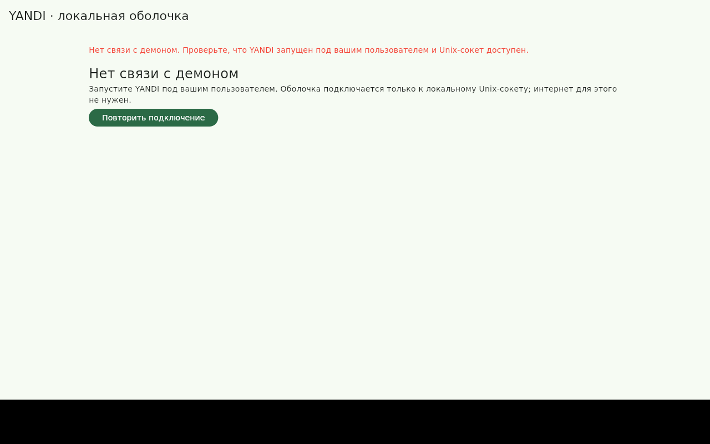
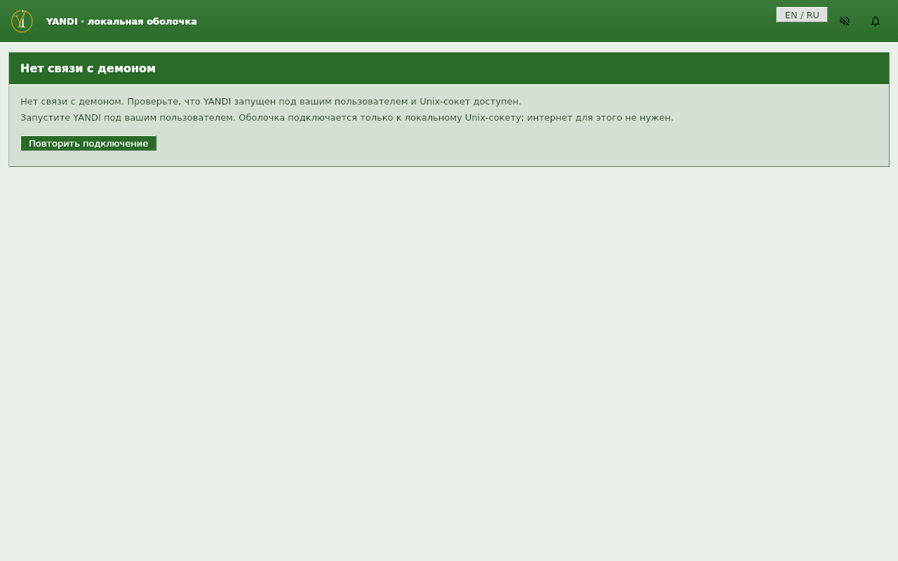
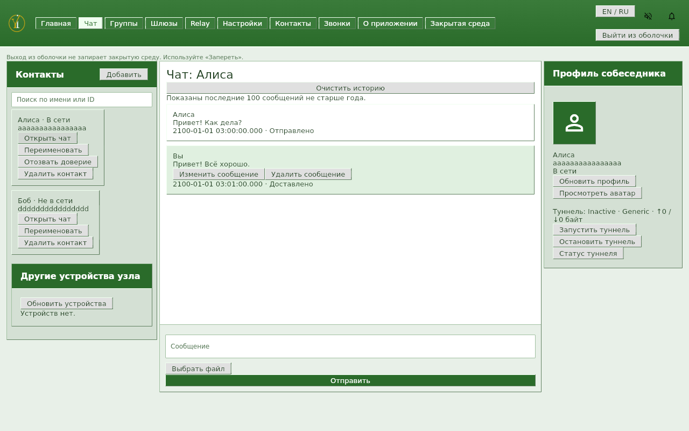
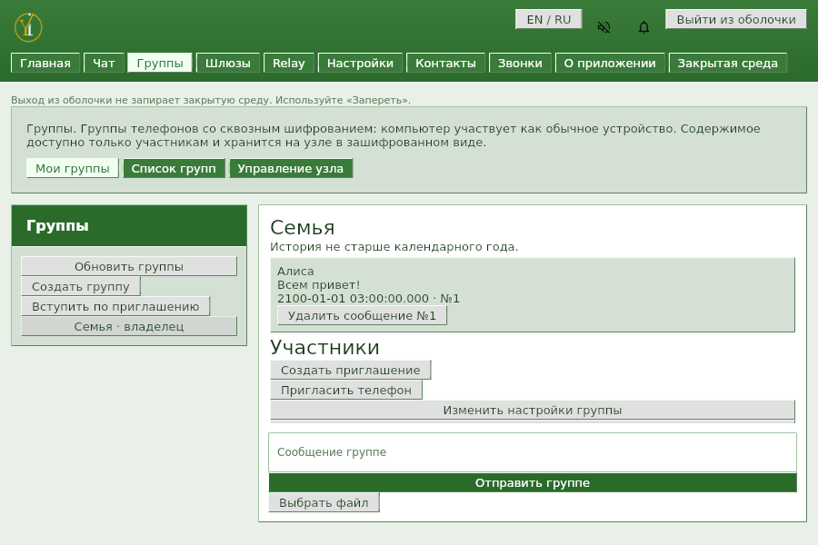

# Оболочка YANDI: ICQ green

2026-10-12 · ветка `codex/shell-design`.

Переработана раскладка Flutter-оболочки по восьми снимкам веб-UI и его CSS/HTML. Палитра, системные шрифты, фаски, рамки и формы собраны в `lib/theme.dart`; общие компоненты: `Panel`, `PageHeader`, `BevelButton`, `TabStrip`, `StatusRow`, `NoticePanel`, `PanelStack`.

Шапка содержит логотип из репозитория, все разделы, EN/RU, звук, уведомления и выход. Главная — таблицы и панели управления; чат — контакты / белое поле переписки с вводом внизу / профиль и туннель; группы — справка, вкладки, список и переписка; настройки, устройства, звонки, шлюзы и Relay используют общую тему. При 900×600 вкладки переносятся, колонки сужаются, списки прокручиваются вертикально. Сохранена работоспособность узких окон из прежних тестов 400×500.

API, domain/repositories, транспорт, политика хранения и очистка секретов не изменены. Вход по uid, проверки закрытой среды и подтверждения действий сохранены; ключ закрытой среды остаётся у демона. Веб-UI сохранён. В эталоне входа тёмная карточка; здесь сохранена её композиция с единой зелёной палитрой из задания и прежним локальным способом входа.

## До / после

До — предоставленный снимок Material-оболочки:



После — реальное Linux-окно без связи с демоном:



Чат после переработки:



Группы в окне 900×600:



## Снимки основных экранов

Все снимки «после» сняты через `xvfb-run` и `import -window root`. Данные синтетические; для стабильных проверок сохранения истории в fixture используются фиксированные даты 2100 года. Тестовые секреты и профили существуют только в памяти.

| Экран | Веб-эталон | Linux после, 1280×800 |
|---|---|---|
| Главная | [Эталон](HANDOFF/reference/web_index.png) | [После](HANDOFF/screenshots/after_dashboard_1280x800.png) |
| Чат | [Эталон](HANDOFF/reference/web_chat.png) | [После](HANDOFF/screenshots/after_chat_1280x800.png) |
| Группы | [Эталон](HANDOFF/reference/web_groups.png) | [После](HANDOFF/screenshots/after_groups_1280x800.png) |
| Настройки | [Эталон](HANDOFF/reference/web_settings.png) | [После](HANDOFF/screenshots/after_settings_1280x800.png) |
| Контакты | [Эталон](HANDOFF/reference/web_contacts.png) | [После](HANDOFF/screenshots/after_contacts_1280x800.png) |
| Шлюзы | [Эталон](HANDOFF/reference/web_gateways.png) | [После](HANDOFF/screenshots/after_gateways_1280x800.png) |
| Relay | [Эталон](HANDOFF/reference/web_relay.png) | [После](HANDOFF/screenshots/after_relay_1280x800.png) |
| Вход | [Эталон](HANDOFF/reference/web_login.png) | [После](HANDOFF/screenshots/after_login_1280x800.png) |
| Первичная настройка | — | [После](HANDOFF/screenshots/after_setup_1280x800.png) |
| Разблокировка | — | [После](HANDOFF/screenshots/after_unlock_1280x800.png) |
| Звонки | — | [После](HANDOFF/screenshots/after_calls_1280x800.png) |
| Нет связи | [До](HANDOFF/screenshots/before_offline.png) | [После](HANDOFF/screenshots/after_offline_1280x800.png) |

900×600: [чат](HANDOFF/screenshots/after_chat_900x600.png), [группы](HANDOFF/screenshots/after_groups_900x600.png), [настройки](HANDOFF/screenshots/after_settings_900x600.png).

## Проверка и воспроизведение

- `flutter analyze --no-pub`: без замечаний.
- `flutter test --no-pub`: **130 тестов проходят**, включая прежние проверки API, логики, блокировки, очистки данных, файлов, устройств и звонков.
- 24 golden-проверки: 12 экранов × 1280×800 / 900×600, настоящий `DesktopApp` с `DesignApi`, системный DejaVu Sans и штатные MaterialIcons. Проверяются отсутствие ошибок раскладки и общая палитра. Эталоны: `test/goldens/`.
- Виджет-тесты адаптированы к названиям вкладок, checkbox-контролам и таблице статуса; проверки не удалены. Проверки аватара теперь отличают `MemoryImage` от нового логотипа-asset.
- Linux release-сборка проверена. Итоговый бинарник снова собран из обычного `lib/main.dart`, который использует локальный Unix API.

Команды из `desktop/yandi_desktop`, Flutter SDK уже установлен локально:

```bash
export PATH=/home/iam/.local/flutter-sdk/bin:$PATH
unset HTTP_PROXY HTTPS_PROXY ALL_PROXY http_proxy https_proxy all_proxy
flutter analyze --no-pub
flutter test --no-pub
flutter build linux --no-pub --target tool/design_preview.dart
python3 tool/capture_design.py
flutter build linux --no-pub
```

Пересоздание golden при намеренном изменении дизайна:

```bash
flutter test --no-pub --update-goldens test/shell_design_golden_test.dart
```

Системный шрифт для golden: `/usr/share/fonts/truetype/dejavu/DejaVuSans.ttf`. Иконки читаются из установленного Flutter SDK; скачивания и новых зависимостей нет. `tool/design_preview.dart` и `tool/design_fixture.dart` используются только для визуальной проверки, боевой entrypoint их не импортирует.

Коммиты разделены: общая оболочка/вход/главная; чат/контакты; группы; шлюзы/Relay; настройки/устройства/звонки; оформление общих контролов; визуальные проверки и этот HANDOFF. `build/`, GeneratedPluginRegistrant.java и CODEX_REVIEW_* не коммитились.
